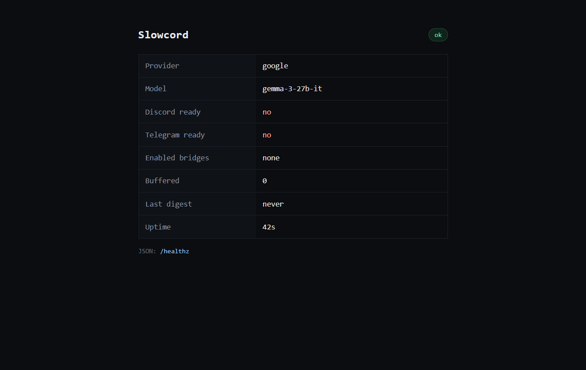

# Slowcord

Slowcord is Discord without keeping Discord open: it reads your servers for you, sends one digest, and posts the replies you tap.

A fork of TediCross for people who would rather stay in Telegram.

## Problem

- Discord only works while you keep another app open, so it becomes a second inbox.
- A real-time bridge forwards every message, and one busy channel interrupts you all day.
- The few messages that need an answer are buried in the unread count, and answering means switching back.

## Solution: how it works

Slowcord is built to be lazy. It refuses to mirror in real time: `/slow on` stops instant forwarding for a bridge and buffers new messages instead. Gemma does the reading, so only the handful of messages that involve you interrupt anything.

- **Digest** — one Telegram message summarizes every buffered channel on your interval, or on `/digest`.
- **Triage** — a message that mentions you is pushed the moment it lands, with a Draft reply button; chatter waits.
- **Draft and approve** — Draft reply writes the answer, and Approve posts it to the channel.

A mirror bot puts Discord in your pocket. Slowcord keeps it out of your day: messages wait for you, not the other way around.

## Demonstration

The status page renders the same fields as `/healthz`, so a run is visible without reading a log.



The 60-second walkthrough:

1. `/servers` lists the Discord servers and text channels the bot can see.
2. `/slow on` switches the bridge to buffering.
3. Six messages arrive: one mentions you, five are chatter. The mention arrives on its own with a Draft reply button.
4. `/digest` returns three bullets and the needs-you list for everything else.
5. Tap Draft reply, then Approve. The reply appears in the channel, authored by the bot.
6. The status page shows the buffer back at zero.

## Tech Stack

| Layer | Technology | Role |
|---|---|---|
| Discord gateway | discord.js 14 | Receives `messageCreate` events and posts approved replies |
| Telegram bot | Telegraf 4 | Commands, digests, mention pushes, and inline buttons |
| Bridge core | TediCross | Settings, bridge map, and the normal relay when slow mode is off |
| Model | Gemma via Google AI | Digest bullets, needs-you list, and draft replies |
| Tracing | Sentry | Spans around buffering, triage, digest, draft, and send |
| Hosting | Render | Runs the bot and the health server |
| Runtime | Node 24 | Runs the TypeScript build |

Gemma runs through Google AI, so the model path needs no local runtime.

## Architecture

`slow.onDiscordMessage` runs inside the TediCross `messageCreate` loop. With slow mode on, it appends a `BufferedMessage` to `data/slow/buffer.jsonl` and returns true so TediCross skips the relay. A message that mentions you is also pushed to Telegram at once, with a draft button. A timer or `/digest` assembles the buffer, validates the digest JSON against buffered ids, and sends it. Approve calls `channel.send`.

```text
Discord gateway
  -> discord.js messageCreate
     -> slow mode on? -- no --> TediCross relay
          |
         yes
          v
  data/slow/buffer.jsonl
          |
          +-- mentions you? --> Telegram push + Draft reply button
          |
  timer or /digest --> Gemma on Google AI --> validated digest JSON
          |
  Telegram digest + needs-you buttons
          |
  Draft --> Approve --> bot posts to Discord
```

## Key Features

- `/servers` and `/channels <guild>` list the Discord servers and text channels the bot can see.
- `/slow on`, `/slow off`, and `/slow status` switch one bridge between buffering and the normal relay.
- Mentions of `SLOW_OWNER_DISCORD_ID` are pushed on arrival with a draft button; everything else waits for the digest.
- Gemma returns three summary bullets and up to six needs-you items, each tied to a buffered message id.
- Draft reply, Regenerate, Cancel, and Approve run from inline buttons; approved text posts as the bot.

## Quick Start

### Prerequisites

- Node.js 24 (`.node-version` pins 24.12.0).
- A Discord application with a bot, Message Content Intent enabled, invited with View Channels, Read Message History, and Send Messages.
- A Telegram bot from BotFather, with privacy mode disabled and admin rights in the group it reads.
- A Google AI Studio key with access to a Gemma model.

### Setup

```bash
git clone https://github.com/0xdfinity/slowcord.git
cd slowcord
npm ci
npm run build
```

`npm ci` reads `package-lock.json`; avoid `npm install`, which can rewrite the lockfile.

Copy the environment file and fill in both bot tokens, the Google AI key, and your Discord user id so triage knows which messages are yours.

```bash
cp .env.example .env
```

Edit `settings.slowcord.yaml`: set the bridge `name`, the Telegram `chatId` (negative), and the Discord `channelId` (quoted). Leave both tokens as `env`.

### Run

```bash
npm run slow
```

`npm run slow` loads `.env` and starts from `settings.slowcord.yaml`.

### Verify

With the service running, the health endpoint answers and reports both bot states:

```bash
curl http://localhost:8787/healthz
```

```json
{"ok":true,"uptime":4,"discordReady":true,"telegramReady":true,"provider":"google","model":"gemma-3-27b-it","enabledBridges":[],"buffered":0,"lastDigestAt":{}}
```

`discordReady` and `telegramReady` are `true` once both bots authenticate. Then follow the walkthrough above to see a real digest: `/servers`, `/slow on`, post in the Discord channel, `/digest`, Draft reply, Approve. The buffered count returns to zero after a digest, and the reply appears in Discord authored by the bot.

### Environment Variables

| Variable | Default | Purpose |
|---|---|---|
| `DISCORD_BOT_TOKEN` | required | Discord bot token |
| `TELEGRAM_BOT_TOKEN` | required | Telegram bot token |
| `SLOW_PROVIDER` | `google` | Model path. `google` is the supported value. |
| `GOOGLE_AI_API_KEY` | required for `google` | Google AI Studio key |
| `GOOGLE_AI_MODEL` | `gemma-3-27b-it` | Gemma model id on Google AI |
| `SLOW_OWNER_DISCORD_ID` | unset | Your Discord user id; mentions of it are pushed at once |
| `SLOW_INTERVAL_MIN` | `30` | Automatic digest cadence in minutes |
| `SLOW_MAX_BUFFER` | `200` | Maximum buffered messages |
| `PORT` | `8787` | Health server port |
| `SENTRY_DSN` | unset | Enables Sentry tracing |
| `SENTRY_ENV` | `development` | Sentry environment tag |

## License

MIT. Slowcord is a fork of [TediCross](https://github.com/TediCross/TediCross), and the upstream copyright notice is kept in [LICENSE](LICENSE).